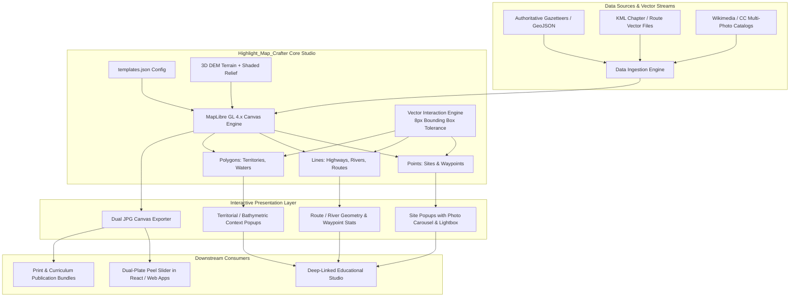

# Highlight_Map_Crafter: Advanced Architecture & Integration Blueprint
### Adapting Highlight_Map_Crafter for Thematic, Historical, and Multi-Geometry Atlas Studios

---

## 🌟 Executive Summary

This document serves as a comprehensive architectural blueprint, technical guide, and upstream feature proposal for **[Highlight_Map_Crafter](https://github.com/GetBack2Basics/Highlight_Map_Crafter)**, based on real-world production enhancements developed in **[BibleStudy-Crafter](https://github.com/GetBack2Basics/BibleStudy-Crafter)** (specifically the live **Biblical Map Crafter** deployment hosted at [`https://storage.googleapis.com/biblestudy-map-crafter/index.html`](https://storage.googleapis.com/biblestudy-map-crafter/index.html)).

By generalizing these advancements, **Highlight_Map_Crafter** can evolve from a point-highlighting utility into a **state-of-the-art, multi-geometry cartographic studio** capable of powering:
- **Historical & Archaeological Atlases** (ancient vs. modern comparisons, archaeological expeditions, territory evolution).
- **Curriculum & Educational Platforms** (literature journeys, historical migration routes, comparative environmental mapping).
- **Interactive Multi-Media Geoweb Applications** (embedded peel sliders, multi-photo carousels, publication-grade dual-plate exports).

---

## 🏗️ High-Level System Architecture



---

## 💡 Key Use Cases & Capabilities

### 1. Thematic & Historical Dual-Template Cartography (Ancient Atlas vs. Modern Satellite)
* **Problem**: Standard mapping tools render present-day boundaries and modern road grids, confusing historical, biblical, or environmental contexts.
* **Solution**: A declarative template system (`templates.json`) switching between:
  - **Ancient / Historical Mode**: Vintage parchment styling, Cinzel serif typography, hand-shaded relief, ancient highways (*Via Maris*, *King's Highway*), bathymetric depth contours, and ancient toponyms (*Salem*, *Kfar Nahum*).
  - **Modern Satellite Mode**: High-resolution ESRI Earth imagery, modern municipal vectors, and contemporary typography.
* **Benefit**: Users can instantly switch context or export matched twin plates for side-by-side or peel-slider comparisons.

### 2. Full-Spectrum Geometry Interactivity (Points, Lines & Polygons)
* **Problem**: Web maps typically restrict clicks to point pins. Clicking routes, journeys, rivers, or regional allotments does nothing.
* **Solution**: A unified vector click engine querying:
  - **Points**: Sites, elevations, coordinates, multi-photo carousels, and historical commentary.
  - **Lines**: Ancient highways, expedition routes, rivers, and borders with calculated waypoint counts and distance profiles.
  - **Polygons**: Territorial provinces, tribal borders, lakes, and seas with vertex counts and regional historical narratives.
* **Hitbox Buffer**: Incorporates an 8-pixel bounding-box query tolerance around cursor clicks, making thin vector lines (`2.5px`–`3.5px`) effortless to click.

### 3. Dynamic On-Demand Vector Streaming (KML & GeoJSON with `@tmcw/togeojson`)
* **Problem**: Statically baking thousands of paths and territories bloats initial page loads and slows down vector rendering.
* **Solution**: Client-side dynamic vector overlay engine that streams book-, chapter-, or study-specific KML/GeoJSON files on demand, parses them with `@tmcw/togeojson`, automatically calculates the bounding box, and fits the viewport.

### 4. Authoritative Photo Carousel & Fullscreen Lightbox
* **Problem**: Sites and landmarks frequently have multiple angles, excavations, aerial shots, and historical street views that cannot fit in a basic popup.
* **Solution**: A responsive, embedded photo carousel (`‹` and `›` controls, counter pill, and photographer credit + Creative Commons badge) paired with a high-resolution lightbox modal for full-screen inspection.

### 5. High-Resolution Dual-JPG Exporter
* **Problem**: Web maps are difficult to print or embed into offline curriculum, research papers, or church study handouts.
* **Solution**: Headless canvas capture (`preserveDrawingBuffer: true`) producing identical camera-angle Ancient and Modern JPG plates at native resolutions.

---

## 💻 Concrete Code Implementations & Blueprint Patterns

### Blueprint A: Declarative Template Configuration (`templates.json`)

Enables `Highlight_Map_Crafter` to dynamically restyle the entire canvas, layers, labels, and 3D terrain based on active template keys:

```json
{
  "templates": {
    "ancient": {
      "id": "ancient",
      "name": "Historical Biblical Atlas",
      "subtitle": "Topographic Physical Relief & Bathymetric Waters",
      "basemap": "geolibre_ocean_topo",
      "canvas_filter": "contrast(1.04) saturate(1.15)",
      "show_boundaries": true,
      "show_roads": true,
      "show_terrain_dem": true,
      "terrain_exaggeration": 2.2,
      "label_field": "ancient_name",
      "font_family": "Cinzel, 'Times New Roman', Georgia, serif",
      "primary_color": "#8d4925",
      "secondary_color": "#d7ccc8",
      "pin_color": "#b71c1c",
      "pin_symbol": "monument"
    },
    "modern": {
      "id": "modern",
      "name": "Contemporary Satellite Context",
      "subtitle": "Present-Day Terrain, Municipal Borders & Satellite Geopolitics",
      "basemap": "esri_satellite",
      "canvas_filter": "none",
      "show_boundaries": false,
      "show_roads": false,
      "show_terrain_dem": true,
      "terrain_exaggeration": 1.5,
      "label_field": "modern_name",
      "font_family": "Inter, -apple-system, BlinkMacSystemFont, sans-serif",
      "primary_color": "#00bcd4",
      "secondary_color": "#263238",
      "pin_color": "#00e5ff",
      "pin_symbol": "location_pin"
    }
  },
  "basemaps": {
    "geolibre_ocean_topo": {
      "name": "GeoLibre Topographic Relief & Depth Bathymetry",
      "tiles": ["https://server.arcgisonline.com/ArcGIS/rest/services/Ocean/World_Ocean_Base/MapServer/tile/{z}/{y}/{x}"],
      "maxzoom": 19
    },
    "esri_satellite": {
      "name": "GeoLibre World Satellite",
      "tiles": ["https://server.arcgisonline.com/ArcGIS/rest/services/World_Imagery/MapServer/tile/{z}/{y}/{x}"],
      "maxzoom": 18
    }
  }
}
```

---

### Blueprint B: Multi-Geometry Vector Click & Hitbox Engine (`setupVectorClickEngine`)

In MapLibre GL JS, thin vector lines (`2px`–`3.5px`) are notoriously difficult to target on touchscreens and mice. This engine implements an 8px bounding-box tolerance and multi-level layer priority (Points $\to$ Lines $\to$ Polygons) so clicking a road running through a province opens the road popup rather than the province fill:

```javascript
/**
 * Setup interactive click and hover handlers across Points, Lines, and Polygons
 * @param {maplibregl.Map} map - Active MapLibre map instance
 */
function setupVectorClickEngine(map) {
  const TOLERANCE_PX = 8;

  // 1. Hover Effect: Change cursor to pointer over any interactive geometry
  map.on('mousemove', (e) => {
    // Skip if hovering existing DOM site marker pins
    if (e.originalEvent && e.originalEvent.target.closest('.site-marker-node')) return;

    const interactiveLayers = getAvailableInteractiveLayers(map);
    if (interactiveLayers.length === 0) {
      map.getCanvas().style.cursor = '';
      return;
    }

    const bbox = [
      [e.point.x - TOLERANCE_PX, e.point.y - TOLERANCE_PX],
      [e.point.x + TOLERANCE_PX, e.point.y + TOLERANCE_PX]
    ];
    const feats = map.queryRenderedFeatures(bbox, { layers: interactiveLayers });
    map.getCanvas().style.cursor = (feats && feats.length > 0) ? 'pointer' : '';
  });

  // 2. Click Handler: Multi-priority feature resolution
  map.on('click', (e) => {
    if (e.originalEvent && (
      e.originalEvent.target.closest('.site-marker-node') ||
      e.originalEvent.target.closest('.maplibregl-popup')
    )) {
      return;
    }

    const interactiveLayers = getAvailableInteractiveLayers(map);
    if (interactiveLayers.length === 0) return;

    const bbox = [
      [e.point.x - TOLERANCE_PX, e.point.y - TOLERANCE_PX],
      [e.point.x + TOLERANCE_PX, e.point.y + TOLERANCE_PX]
    ];

    // Priority 1: Point features (exact location markers)
    let candidates = map.queryRenderedFeatures(bbox, {
      layers: interactiveLayers.filter(l => l.includes('point') || l.includes('circle'))
    });

    // Priority 2: Line features (ancient highways, journey routes, rivers, borders)
    if (!candidates || candidates.length === 0) {
      candidates = map.queryRenderedFeatures(bbox, {
        layers: interactiveLayers.filter(l => l.includes('line') || l.includes('road') || l.includes('river') || l.includes('stroke'))
      });
    }

    // Priority 3: Polygon features (provinces, territories, lakes, seas)
    if (!candidates || candidates.length === 0) {
      candidates = map.queryRenderedFeatures(e.point, {
        layers: interactiveLayers.filter(l => l.includes('fill') || l.includes('shelf') || l.includes('depth'))
      });
    }

    if (!candidates || candidates.length === 0) return;

    const feature = candidates[0];
    showFeaturePopup(feature, e.lngLat, map);
  });
}

function getAvailableInteractiveLayers(map) {
  const candidateLayerIds = [
    'overlay-points',
    'overlay-lines',
    'overlay-fills',
    'ancient-roads-line',
    'ancient-rivers-line',
    'ancient-provinces-stroke',
    'ancient-water-stroke',
    'ancient-water-shelf',
    'ancient-provinces-fill'
  ];

  return candidateLayerIds.filter(id => {
    if (!map.getLayer(id)) return false;
    const vis = map.getLayoutProperty(id, 'visibility');
    return vis !== 'none';
  });
}
```

---

### Blueprint C: Geometry-Tailored Popup Generator

Renders rich cards adapting to whether the clicked feature is a Point, LineString, or Polygon:

```javascript
/**
 * Render popup customized by geometry type and metadata
 */
function showFeaturePopup(feat, lngLat, map) {
  const props = feat.properties || {};
  const geomType = feat.geometry ? feat.geometry.type : 'Feature';
  
  let badgeLabel = '📍 Location';
  let badgeColor = '#d97706';

  if (geomType === 'LineString' || geomType === 'MultiLineString') {
    badgeLabel = props.category === 'river' ? '🌊 River / Waterway' : '🛣️ Trade Highway / Route';
    badgeColor = '#b71c1c';
  } else if (geomType === 'Polygon' || geomType === 'MultiPolygon') {
    badgeLabel = props.category?.includes('water') ? '⚓ Body of Water' : '🗺️ Territory / Province';
    badgeColor = '#0284c7';
  }

  const title = props.name || props.title || 'Cartographic Feature';
  const desc = props.description || '';

  // Geometry statistics rows
  const metaRows = [];
  if (geomType === 'Point' && feat.geometry.coordinates) {
    const [pLon, pLat] = feat.geometry.coordinates;
    metaRows.push(`<tr><td>Coordinates:</td><td><code>${pLat.toFixed(4)}°N, ${pLon.toFixed(4)}°E</code></td></tr>`);
  } else if (geomType.includes('LineString') && feat.geometry.coordinates) {
    metaRows.push(`<tr><td>Route Geometry:</td><td>${feat.geometry.coordinates.length} waypoints</td></tr>`);
  } else if (geomType.includes('Polygon') && feat.geometry.coordinates) {
    const ring = feat.geometry.coordinates[0] || [];
    metaRows.push(`<tr><td>Boundary:</td><td>${ring.length} boundary vertices</td></tr>`);
  }

  metaRows.push(`<tr><td>Clicked At:</td><td><code>${lngLat.lat.toFixed(4)}°N, ${lngLat.lng.toFixed(4)}°E</code></td></tr>`);

  const popupHtml = `
    <div class="vector-feature-popup-card">
      <div class="vector-popup-header">
        <span class="vector-popup-badge" style="background: ${badgeColor};">${badgeLabel}</span>
        <h4 class="vector-popup-title">${escapeHtml(title)}</h4>
      </div>
      ${desc ? `<div class="vector-popup-desc">${cleanDescriptionHtml(desc)}</div>` : ''}
      <div class="vector-attrs-section">
        <table class="vector-attrs-table">
          <tbody>${metaRows.join('')}</tbody>
        </table>
      </div>
    </div>
  `;

  new maplibregl.Popup({
    offset: 10,
    maxWidth: '320px',
    className: 'crafter-vector-popup',
    closeOnClick: true
  })
    .setLngLat(lngLat)
    .setHTML(popupHtml)
    .addTo(map);
}
```

---

### Blueprint D: Multi-Photo Carousel & Lightbox Engine

Supports multiple authoritative photographs per site with thumbnail carousel controls and a fullscreen lightbox modal:

```javascript
// Global State for Site Photos
const siteActivePhotoIndices = {};

/**
 * Navigate through a site's photo catalog inside its open popup
 */
function navigatePopupPhoto(siteId, delta, event) {
  if (event) event.stopPropagation();
  const site = sitesGeoJSON.features.find(f => f.properties.id === siteId);
  if (!site || !site.properties.photos) return;

  const photos = site.properties.photos;
  let idx = (siteActivePhotoIndices[siteId] || 0) + delta;
  if (idx < 0) idx = photos.length - 1;
  if (idx >= photos.length) idx = 0;
  siteActivePhotoIndices[siteId] = idx;

  const activePhoto = photos[idx];
  const imgEl = document.getElementById(`popup-photo-img-${siteId}`);
  const counterEl = document.getElementById(`popup-counter-${siteId}`);
  const captionEl = document.getElementById(`popup-caption-${siteId}`);
  const creditContainer = document.getElementById(`popup-credit-container-${siteId}`);

  if (imgEl && activePhoto.thumb_url) imgEl.src = activePhoto.thumb_url;
  if (counterEl) counterEl.textContent = `${idx + 1} / ${photos.length}`;
  if (captionEl) captionEl.textContent = activePhoto.caption || site.properties.name;
  if (creditContainer) {
    creditContainer.innerHTML = activePhoto.credit_url
      ? `<a href="${activePhoto.credit_url}" target="_blank" rel="noopener">© ${activePhoto.credit}</a>`
      : `<span>© ${activePhoto.credit || 'Wikimedia Commons'}</span>`;
  }
}

/**
 * Open high-resolution lightbox modal
 */
function openLightbox(siteId, event) {
  if (event) event.stopPropagation();
  const site = sitesGeoJSON.features.find(f => f.properties.id === siteId);
  if (!site || !site.properties.photos) return;

  currentLightboxSite = site;
  currentLightboxIndex = siteActivePhotoIndices[siteId] || 0;

  const modal = document.getElementById('modal-lightbox');
  renderLightbox();
  if (modal) modal.classList.add('open');
}
```

---

### Blueprint E: Client-Side Vector Streaming & Parsing (`@tmcw/togeojson`)

Enables the map to load KML tracks directly from remote repositories or static directories without backend transformation:

```javascript
/**
 * Stream and overlay authoritative KML vector files
 * @param {string} fileKey - E.g. 'acts', 'exodus', 'paul_journey_2'
 */
async function loadKmlVectorOverlay(fileKey, map) {
  try {
    const resp = await fetch(`data/kml/${fileKey}.kml`);
    if (!resp.ok) throw new Error(`HTTP ${resp.status}`);
    const kmlText = await resp.text();

    const dom = new DOMParser().parseFromString(kmlText, 'text/xml');
    const geojson = window.toGeoJSON.kml(dom);

    // Remove previous overlay layers
    ['kml-fills', 'kml-lines', 'kml-points'].forEach(id => {
      if (map.getLayer(id)) map.removeLayer(id);
    });
    if (map.getSource('kml-source')) map.removeSource('kml-source');

    map.addSource('kml-source', { type: 'geojson', data: geojson });

    // Add Polygon fills
    map.addLayer({
      id: 'kml-fills',
      type: 'fill',
      source: 'kml-source',
      filter: ['==', '$type', 'Polygon'],
      paint: { 'fill-color': '#0284c7', 'fill-opacity': 0.22 }
    });

    // Add Routes / Rivers (Lines)
    map.addLayer({
      id: 'kml-lines',
      type: 'line',
      source: 'kml-source',
      filter: ['==', '$type', 'LineString'],
      paint: { 'line-color': '#b71c1c', 'line-width': 3.5, 'line-dasharray': [3, 2] }
    });

    // Add Locations (Points)
    map.addLayer({
      id: 'kml-points',
      type: 'circle',
      source: 'kml-source',
      filter: ['==', '$type', 'Point'],
      paint: { 'circle-radius': 5.5, 'circle-color': '#d97706', 'circle-stroke-width': 1.5, 'circle-stroke-color': '#ffffff' }
    });

    // Fit camera to feature bounds
    const bbox = computeGeoJsonBBox(geojson);
    if (bbox) map.fitBounds(bbox, { padding: 40, duration: 1000 });
  } catch (err) {
    console.error('Failed to load KML:', err);
  }
}
```

---

### Blueprint F: Dual-JPG Headless Capture Pipeline

Allows `Highlight_Map_Crafter` to generate publication-ready comparative map plates from the live canvas:

```javascript
/**
 * Capture high-resolution twin plates: Ancient Atlas and Modern Satellite
 */
async function captureDualPlates(map) {
  const originalTemplate = currentTemplate;

  // 1. Render & capture Ancient plate
  applyTemplate('ancient');
  await waitForMapIdle(map);
  const ancientBlob = await captureCanvasBlob(map);

  // 2. Render & capture Modern plate
  applyTemplate('modern');
  await waitForMapIdle(map);
  const modernBlob = await captureCanvasBlob(map);

  // Restore state
  applyTemplate(originalTemplate);

  return {
    ancientJpg: ancientBlob,
    modernJpg: modernBlob
  };
}

function captureCanvasBlob(map) {
  return new Promise((resolve) => {
    map.getCanvas().toBlob((blob) => resolve(blob), 'image/jpeg', 0.92);
  });
}

function waitForMapIdle(map) {
  return new Promise((resolve) => {
    map.once('idle', () => setTimeout(resolve, 250));
  });
}
```

---

### Blueprint G: Downstream Consumer Integration (React & Peel Slider)

How downstream applications (like `BibleStudy-Crafter`) consume the generated plates and studio links:

```tsx
/**
 * BiblicalMapSection.tsx (React + TypeScript)
 * Interactive peel slider comparing Ancient vs. Modern Map Crafter plates
 */
export const BiblicalMapSection: React.FC<MapSectionProps> = ({ study }) => {
  const [sliderPos, setSliderPos] = useState(50); // 0% to 100%
  const [activePhotoModal, setActivePhotoModal] = useState<Photo | null>(null);

  const ancientPlateUrl = study.mapPlates.ancientUrl;
  const modernPlateUrl = study.mapPlates.modernUrl;
  const studioDeepLink = `https://storage.googleapis.com/biblestudy-map-crafter/index.html?period=${study.era}&book=${study.bookCode}`;

  return (
    <div class="relative w-full h-[540px] rounded-2xl overflow-hidden border border-amber-900/20 shadow-xl select-none">
      {/* Background Plate: Modern Satellite */}
      

      {/* Foreground Plate: Ancient Atlas (Clipped by slider position) */}
      <div 
        class="absolute inset-0 overflow-hidden" 
        style={{ width: `${sliderPos}%` }}
      >
        
      </div>

      {/* Peel Slider Divider Handle */}
      <div 
        class="absolute top-0 bottom-0 w-1 bg-amber-400 cursor-ew-resize z-20"
        style={{ left: `${sliderPos}%` }}
      >
        <div class="absolute top-1/2 -translate-y-1/2 -translate-x-1/2 w-8 h-8 rounded-full bg-amber-500 text-stone-900 font-bold flex items-center justify-center shadow-lg">
          ‹›
        </div>
      </div>

      {/* Deep-link to Highlight_Map_Crafter / Map Crafter Studio */}
      <a 
        href={studioDeepLink} 
        target="_blank" 
        rel="noopener noreferrer"
        class="absolute top-4 right-4 z-30 px-3 py-1.5 rounded-lg bg-stone-900/80 backdrop-blur text-amber-300 text-xs font-semibold hover:bg-stone-900 flex items-center gap-1.5 border border-amber-500/30"
      >
        🗺️ Open in Map Crafter Studio
      </a>
    </div>
  );
};
```

---

## 🚀 Upstream Recommendation & PR Roadmap for `Highlight_Map_Crafter`

To incorporate these battle-tested patterns into the main [Highlight_Map_Crafter](https://github.com/GetBack2Basics/Highlight_Map_Crafter) repository, the following phased release roadmap is recommended:

| Phase | Feature Milestone | Key Deliverables |
| :--- | :--- | :--- |
| **Phase 1** | **Multi-Geometry Hitbox Engine** | - Add `setupVectorClickEngine` with 8px bounding-box tolerance.<br/>- Support click popups on `LineString` and `Polygon` layers (not just `Point` markers).<br/>- Introduce geometry statistics (waypoints count, vertex count). |
| **Phase 2** | **Multi-Photo Metadata & Carousels** | - Extend site schema to support `photos: [...]` array.<br/>- Build responsive popup carousel with prev/next buttons and counter badge.<br/>- Add fullscreen lightbox modal support for high-res photo inspection. |
| **Phase 3** | **Dynamic Vector Streaming (KML/GeoJSON)** | - Integrate `@tmcw/togeojson` client-side parsing.<br/>- Add dropdown/API selector to stream external book/route/expedition files.<br/>- Auto-bounding box fitting via `computeGeoJsonBBox`. |
| **Phase 4** | **Dual Template Configuration System** | - Externalize styling into `templates.json` (Ancient Historical vs. Modern Satellite).<br/>- Support canvas CSS filter tokens, 3D DEM exaggeration, and font styling.<br/>- Dual-JPG high-resolution canvas capture exporter. |
| **Phase 5** | **Downstream Integration Protocols** | - URL parameter deep-linking (`?period=...&book=...&lat=...&lng=...&zoom=...`).<br/>- React peel-slider starter component in `examples/`.<br/>- Static deployment automation script (GCS / S3 / GitHub Pages). |

---

## 📜 Credits and Attribution

- **BibleStudy-Crafter Project**: [`https://github.com/GetBack2Basics/BibleStudy-Crafter`](https://github.com/GetBack2Basics/BibleStudy-Crafter)
- **Authoritative Geocoding Data**: [OpenBible.info Bible-Geocoding-Data](https://github.com/openbibleinfo/Bible-Geocoding-Data)
- **Map Engine**: [MapLibre GL JS](https://maplibre.org/)
- **KML Conversion**: [@tmcw/togeojson](https://github.com/tmcw/togeojson)
- **Topographic & Shaded Relief**: GeoLibre / ESRI World Ocean Base & World Shaded Relief
