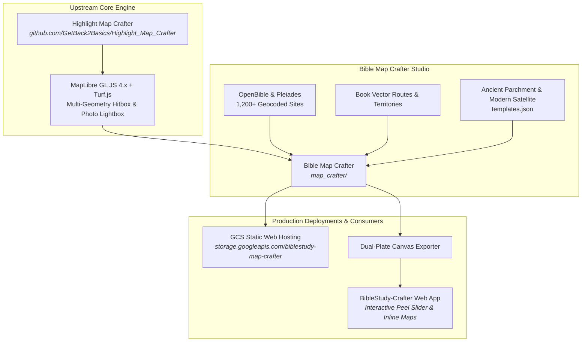

# 🗺️ Bible Map Crafter & Template Studio

[](../LICENSE)
[](https://maplibre.org/)
[](https://cloud.google.com/storage)
[](https://github.com/GetBack2Basics/Highlight_Map_Crafter)
[](https://www.openbible.info/geo/)

> **An interactive, publication-grade biblical cartography studio for historical, theological, and archaeological spatial exploration.**

---

## 🌟 Live Studio & Links

- 🌐 **Live Web Application (GCS)**: [https://storage.googleapis.com/biblestudy-map-crafter/index.html](https://storage.googleapis.com/biblestudy-map-crafter/index.html)
- 📄 **Slide Deck Showcase (PDF)**: [docs/Bible_Map_Crafter_Thematic_Studio_Showcase.pdf](../docs/Bible_Map_Crafter_Thematic_Studio_Showcase.pdf)
- 📖 **Parent Platform**: [BibleStudy-Crafter](https://github.com/GetBack2Basics/BibleStudy-Crafter)
- 🗺️ **Upstream Core Engine**: [Highlight Map Crafter](https://github.com/GetBack2Basics/Highlight_Map_Crafter)
- 📘 **Integration Blueprint**: [docs/highlight_map_crafter_integration_blueprint.md](../docs/highlight_map_crafter_integration_blueprint.md)

---

## 🏛️ What is Bible Map Crafter?

**Bible Map Crafter** is a dedicated, serverless geospatial mapping application built to bring biblical geography and archaeology alive. Standard mapping software defaults to present-day borders, modern asphalt highways, and urban grids—creating anachronistic confusion when studying ancient history.

Bible Map Crafter solves this by pairing **authoritative historical gazetteers** (over 1,200 biblical sites geocoded from OpenBible.info, Pleiades, and Wikidata) with **custom thematic relief styling**, era-specific territorial boundaries, and interactive journey vectors.

Adapted directly from the core geospatial engine of **[Highlight Map Crafter](https://github.com/GetBack2Basics/Highlight_Map_Crafter)**, Bible Map Crafter extends the engine into a specialized historical and biblical atlas studio that powers both standalone exploration and downstream interactive peel sliders inside [BibleStudy-Crafter](https://github.com/GetBack2Basics/BibleStudy-Crafter).

---

## ✨ Key Capabilities

| Feature | Description |
| :--- | :--- |
| **📜 Dual-Template Cartography** | Instant one-click toggle between **Ancient Historical Atlas** (vintage parchment relief, warm sepia hillshades, ancient kingdom borders) and **Modern Satellite** (high-resolution ESRI imagery). |
| **📍 1,200+ Authoritative Biblical Sites** | Fully geocoded coordinates, historical names, archaeological significance, and biblical references synchronized with OpenBible.info and Pleiades. |
| **🎯 Multi-Geometry Hitbox Engine** | 8px bounding-box click tolerance for interactive journeys (e.g. Paul's Missionary Journeys, Exodus routes) and territorial polygons (Tribal Allotments, Roman Provinces). |
| **🖼️ Multi-Photo Carousel & Lightbox** | Multi-photo archaeological gallery per site with verified Wikimedia Commons photography, licensing badges, responsive carousel controls, and keyboard-driven lightbox. |
| **⏳ Historical Era Filtering** | Filter sites and boundaries by biblical epoch: Patriarchal (~2000–1600 BC), Exodus & Wilderness (~1446 BC), United Monarchy (~1000 BC), Roman Judea & Galilee (~30 AD), or Early Church (~50–95 AD). |
| **📁 Dynamic Vector Streaming (KML)** | Stream scripture book-specific travel routes and regional boundaries on demand using `@tmcw/togeojson` with automatic bounding-box fitting. |
| **📸 Publication Dual-Plate Exporter** | Export synchronized, publication-ready high-resolution JPEG plates directly from the live MapLibre canvas for curriculum, print, and study guides. |
| **✏️ In-Browser Site Editor** | Add, edit, or adjust archaeological coordinates, descriptions, and media metadata directly in the browser with one-click JSON export. |

---

## 🏗️ Architecture & Upstream Relationship



---

## 📁 Directory Structure

```text
map_crafter/
├── data/
│   ├── biblical_sites.geojson       # 1,200+ geocoded sites with photos & descriptions
│   ├── templates.json               # Ancient parchment & modern satellite layer specs
│   └── kml/                         # Authoritative route & territorial boundary vectors
├── app.js                           # MapLibre application logic, hitbox engine & UI handlers
├── index.html                       # Studio layout, era selector, lightbox & export modals
├── style.css                        # Parchment-inspired typography and responsive styling
├── deploy_to_gcs.ps1                # Automated PowerShell Google Cloud Storage deployment
└── README.md                        # Documentation & upstream reference guide
```

---

## 🚀 Quick Start (Local Preview)

### 1. Prerequisites
- Any modern web browser
- Any local static HTTP server (e.g. Python, Node.js, or VS Code Live Server)

### 2. Run with Python
From the repository root:
```bash
# Using Python
python -m http.server 8080 --directory map_crafter
```
Then open your browser to [http://localhost:8080](http://localhost:8080).

### 3. Run with Node.js
```bash
# Using npx serve
npx serve map_crafter -p 8080
```

---

## ☁️ Deployment to Google Cloud Storage

Bible Map Crafter deploys as a serverless static web application directly to Google Cloud Storage:

```powershell
# From the map_crafter directory
.\deploy_to_gcs.ps1 -BucketName "biblestudy-map-crafter" -Region "australia-southeast1"
```

The script automatically:
1. Provisions the GCS bucket with uniform bucket-level access.
2. Configures web hosting (`--web-main-page-suffix=index.html`).
3. Sets public read permissions (`roles/storage.objectViewer` for `allUsers`).
4. Uploads all HTML, CSS, JavaScript, and GeoJSON assets with proper cache headers.

---

## 🤝 Upstream Credits & Attribution

- **Geospatial Engine Core**: Derived from **[Highlight Map Crafter](https://github.com/GetBack2Basics/Highlight_Map_Crafter)** by GetBack2Basics.
- **Gazetteer & Geocoding**: [OpenBible.info](https://www.openbible.info/geo/) under CC-BY, with cross-references to [Pleiades](https://pleiades.stoa.org/) and [Wikidata](https://www.wikidata.org/).
- **Mapping Framework**: [MapLibre GL JS 4.x](https://maplibre.org/) and [@tmcw/togeojson](https://github.com/tmcw/togeojson).
- **Cartographic Basemaps**: OpenTopoMap, ESRI World Imagery, CARTO Voyager, and Stamen Watercolor.

---

## 📄 License

This project is licensed under the [MIT License](../LICENSE) as part of [BibleStudy-Crafter](https://github.com/GetBack2Basics/BibleStudy-Crafter).
